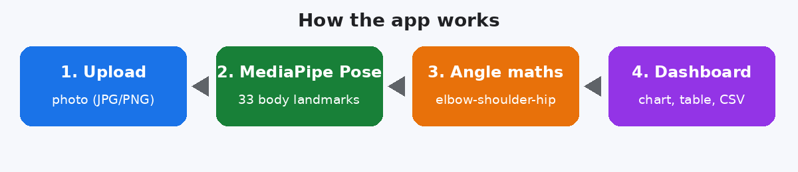
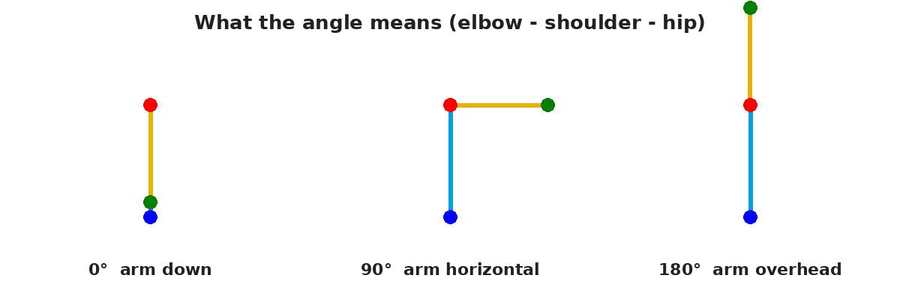
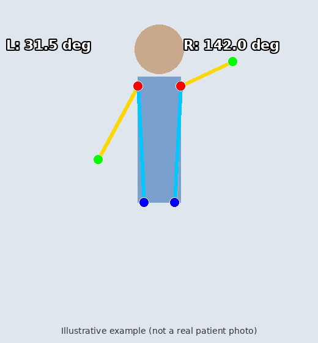
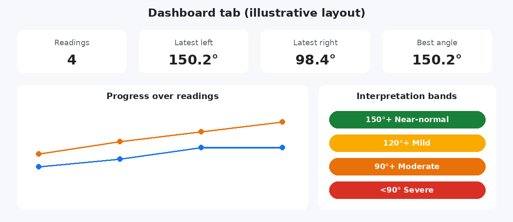

<div align="center">

# 🦾 Frozen Shoulder Angle Detector

**AI-powered web app that measures shoulder arm-elevation angle from a single photo, tracks progress on a live dashboard, and integrates Ayurveda information.**

[](https://frozenshoulderangle.streamlit.app/)
[](https://doi.org/10.1109/ICICT64420.2025.11005192)


[🌐 Live Demo](https://frozenshoulderangle.streamlit.app/) · [📄 Publication](#-publication) · [✨ Features](#-features) · [🧠 How It Works](#-how-it-works) · [🚀 Quick Start](#-quick-start) · [📁 Structure](#-project-structure)

</div>

---

## 📌 Summary
Frozen shoulder (adhesive capsulitis) limits arm movement, and tracking recovery usually needs a goniometer and a clinic visit. This project lets anyone upload a **frontal photo** and get the **left and right shoulder angle** in seconds, using **MediaPipe Pose** and **OpenCV**. Readings are saved to a **dashboard** so progress can be followed over time, and an **Ayurveda tab** supports integrative-care discussion.

> ⚠️ Educational / research tool. Not a medical device and not a diagnosis.

## 🌐 Live Demo
👉 **https://frozenshoulderangle.streamlit.app/**

No installation needed. Upload a photo, view the annotated result, save readings, and explore the dashboard. If the app is asleep, click **Wake up** and wait about a minute.



## ✨ Features
| Feature | Description |
|---|---|
| 📷 Photo analysis | Upload JPG/PNG, get left and right angles together |
| 🖼️ Annotated output | Landmarks and angle drawn on the image, downloadable |
| 🛡️ Visibility check | Warns instead of showing a guessed angle when shoulder, elbow or hip is hidden |
| 📊 Live dashboard | Progress chart, left-vs-right chart, readings table, CSV export |
| 🎨 Result bands | Colour-coded interpretation (indicative only) |
| 🌿 Ayurveda tab | Educational information on *Apabahuka* (non-prescriptive) |
| ✅ Tested | Unit tests for the angle maths (`pytest`) |

## 🧠 How It Works
1. **MediaPipe Pose** detects 33 body landmarks on the photo.
2. The app takes three points: **shoulder, elbow, hip**.
3. It computes the angle at the shoulder between the elbow and the hip.



| Angle | Meaning |
|---|---|
| 0° | Arm by the side |
| 90° | Arm horizontal |
| 180° | Arm overhead |



*Illustrative drawing, not a real patient photo.*

## 📊 Dashboard
Press **Save to dashboard** after an analysis. Each reading is added to the charts and table; use **Download CSV** to keep the data.



| Band | Angle |
|---|---|
| 🟢 Near-normal range | 150°+ |
| 🟡 Mildly restricted | 120–150° |
| 🟠 Moderately restricted | 90–120° |
| 🔴 Severely restricted | below 90° |

Bands are indicative only and assume an arm-elevation photo. Clinical judgement decides.

## 📄 Publication
This project is the implementation behind my published paper:

> **Web-Based Application to Calculate the Angle of Frozen Shoulder Using AI and Machine Learning With Ayurveda Integration**
> Saniya Saratkar, *et al.*
> 2025 International Conference on Inventive Computation Technologies (**ICICT**), April 2025
> DOI: [10.1109/ICICT64420.2025.11005192](https://doi.org/10.1109/ICICT64420.2025.11005192)

<details>
<summary><b>📎 Cite this work (BibTeX)</b></summary>

```bibtex
@inproceedings{saratkar2025frozenshoulder,
  author    = {Saratkar, Saniya},
  title     = {Web-Based Application to Calculate the Angle of Frozen Shoulder Using AI and Machine Learning With Ayurveda Integration},
  booktitle = {2025 International Conference on Inventive Computation Technologies (ICICT)},
  year      = {2025},
  month     = apr,
  doi       = {10.1109/ICICT64420.2025.11005192}
}
```
</details>

## 🚀 Quick Start
```bash
git clone https://github.com/Saniya1312S/frozen_shoulder_angle.git
cd frozen_shoulder_angle
python -m venv .venv
source .venv/bin/activate        # Windows: .venv\Scripts\activate
pip install -r requirements.txt
streamlit run app.py
```
Use **Python 3.10, 3.11 or 3.12** (MediaPipe 0.10.21 does not support 3.13). Run tests with `pip install pytest && pytest`.

## ☁️ Deployment
- **Streamlit Community Cloud** (used for the live demo): repo → `app.py` → Python 3.11 → Deploy.
- **Docker / Render / Hugging Face Spaces:** `docker build -t fsa . && docker run -p 8501:8501 fsa`

## 📁 Project Structure
```
frozen_shoulder_angle/
├── app.py                # Streamlit UI (Analyze, Dashboard, Ayurveda, About)
├── utils/
│   └── pose_utils.py     # pose detection, angle maths, annotation
├── tests/                # pytest unit tests
├── assets/               # README images
├── requirements.txt      # Python packages
├── packages.txt          # system libraries for Streamlit Cloud
├── Dockerfile
├── CITATION.cff          # "Cite this repository" button on GitHub
├── LICENSE
└── .streamlit/config.toml
```

## 📸 Tips for Good Results
Frontal photo · full torso and arm visible · plain background · good light · fitted clothing · camera at chest height.

## ⚠️ Limitations & Privacy
- A single 2-D photo: camera angle and posture change the number.
- Not clinically validated; compare against a goniometer before relying on it.
- Photos are processed in memory and not stored by the app, but the cloud host still receives them. Get patient consent.

## 🛠️ Tech Stack
Python · Streamlit · MediaPipe Pose · OpenCV · NumPy · Pandas · Pillow · pytest · Docker

## 👩‍💻 Author
**Saniya Saratkar** · [GitHub @Saniya1312S](https://github.com/Saniya1312S)

## 📝 License
Released under the [MIT License](LICENSE).
